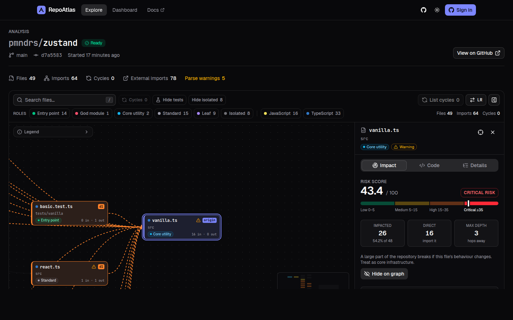

<div align="center">


# RepoAtlas

**Interactive codebase dependency visualizer, blast-radius simulator and self-healing onboarding tours for GitHub repositories.**

[](https://github.com/AadithyaAle/Repoatlas/actions/workflows/ci-backend.yml)
[](https://github.com/AadithyaAle/Repoatlas/actions/workflows/ci-frontend.yml)
[](https://github.com/AadithyaAle/Repoatlas/actions/workflows/codeql.yml)
[](https://aadithyaale.github.io/Repoatlas/)
[](LICENSE)

[**Live app**](https://repoatlas-nine.vercel.app) ·
[**Documentation**](https://aadithyaale.github.io/Repoatlas/) ·
[Getting started](https://aadithyaale.github.io/Repoatlas/getting-started.html) ·
[Architecture](https://aadithyaale.github.io/Repoatlas/architecture.html) ·
[API reference](https://aadithyaale.github.io/Repoatlas/api.html) ·
[Report a bug](https://github.com/AadithyaAle/Repoatlas/issues/new/choose)

</div>

---

<p align="center">
  
</p>

> The API runs on Render's free plan, so the **first request after a period of inactivity can take
> about 50 seconds** while the instance wakes up. The web app sends a silent health request on first
> page load ([`api-warmup.tsx`](frontend/src/components/common/api-warmup.tsx)) so the API usually
> finishes booting while you read the landing page.

## Problem statement

Onboarding onto an unfamiliar codebase is slow and overwhelming. New contributors cannot see
which files matter, what depends on what, or how risky a change is. Written onboarding material
(READMEs, wikis, "start here" docs) lives apart from the code and **silently goes stale** as soon as
someone pushes a commit that moves or rewrites the code it describes.

## Target users

- **Open-source maintainers** who want contributors to understand a project's structure quickly.
- **Engineering team leads** who onboard new hires onto large, evolving services.
- **New developers and students** exploring complex repositories on their own.

## Solution

RepoAtlas parses a public GitHub repository into an **abstract-syntax-tree-derived dependency
graph**, lets you simulate the **blast radius** of changing any file, and lets maintainers publish
**pin-to-code onboarding tours** whose steps are anchored to exact line ranges. When the repository
changes, a **self-healing drift engine** re-locates moved code automatically and flags steps whose
code was actually modified, with a side-by-side diff for review.

Everything core is deterministic software engineering (parsers, graph algorithms, hashing and
text matching). The optional Gemini integration only drafts explanations from facts the engine
already computed.

## Key features

| Workflow | What users can do | Where it lives |
|---|---|---|
| **1. GitHub ingestion & AST graph** | Paste a repo URL; RepoAtlas pins the latest commit, downloads one tarball, parses Python (`ast`) and JS/TS/JSX/TSX ([tree-sitter](https://tree-sitter.github.io/tree-sitter/)), resolves relative, `tsconfig` alias and Python package imports, and tracks progress live (`PENDING → FETCHING_TREE → PARSING_AST → COMPUTING_GRAPH → COMPLETED`). | [`ast_parser.py`](backend/app/engine/ast_parser.py), [`resolver.py`](backend/app/engine/resolver.py), [`github_service.py`](backend/app/services/github_service.py), [`analysis_worker.py`](backend/app/workers/analysis_worker.py) |
| **2. Blast radius & cycles** | Click any file to see who imports it directly and transitively (reverse BFS), an impact % and depth-weighted risk score, import cycles (3-colour DFS + Tarjan SCC), and architectural roles (Entry Point, Core Utility, God Module, Leaf, Isolated). | [`graph_algorithms.py`](backend/app/engine/graph_algorithms.py), [`frontend/src/components/graph`](frontend/src/components/graph) |
| **3. Pin-to-code tours** | Maintainers select lines in the code viewer, write Markdown and add multiple-choice checkpoints. Trainees play the tour; the canvas pans to each file, the lines are highlighted, and steps unlock in order once the checkpoint is answered. | [`tour_service.py`](backend/app/services/tour_service.py), [`progress_service.py`](backend/app/services/progress_service.py), [`frontend/src/components/tours`](frontend/src/components/tours) |
| **4. Self-healing drift engine** | "Sync & verify" compares each step's SHA-256 snippet hash against the latest commit: `HEALTHY`, `DRIFTED_AUTO_FIXED` (moved, lines updated), `OUTDATED_NEEDS_REVIEW` (changed, diff + proposed location) or `BROKEN_FILE_DELETED`, with accept / keep / re-pin actions. | [`drift_detector.py`](backend/app/engine/drift_detector.py), [`drift_service.py`](backend/app/services/drift_service.py) |
| **Architecture report export** | One click in the graph toolbar downloads an `ARCHITECTURE.md`: summary metrics, a Mermaid diagram of the most central files, the riskiest files (same reverse-BFS formulas as the API), roles, cycles and commit-pinned permalinks. Generated in the browser. | [`architecture-report.ts`](frontend/src/lib/report/architecture-report.ts), [`export-report-button.tsx`](frontend/src/components/graph/export-report-button.tsx) |
| **Dashboard** | Repository analytics (roles, languages, riskiest files), tour health with sync history, trainee progress and first-try accuracy, and your own learning progress. | [`dashboard_service.py`](backend/app/services/dashboard_service.py), [`frontend/src/components/dashboard`](frontend/src/components/dashboard) |
| **AI step drafts (optional)** | Draft a step title, explanation and checkpoint for a pinned range, grounded in the file's role, imports, dependents and blast radius. Output is schema-validated, cached and rate-limited. | [`ai_service.py`](backend/app/services/ai_service.py) |

### Core algorithms at a glance

| Algorithm | Source (permalink) |
|---|---|
| Reverse-BFS blast radius | [`blast_radius`](https://github.com/AadithyaAle/Repoatlas/blob/66aa7feae30aefa6f3b63720829eda0563fce569/backend/app/engine/graph_algorithms.py#L69) · [`risk_score`](https://github.com/AadithyaAle/Repoatlas/blob/66aa7feae30aefa6f3b63720829eda0563fce569/backend/app/engine/graph_algorithms.py#L96) |
| Iterative 3-colour DFS + Tarjan SCC | [`detect_cycles`](https://github.com/AadithyaAle/Repoatlas/blob/66aa7feae30aefa6f3b63720829eda0563fce569/backend/app/engine/graph_algorithms.py#L200) |
| Role classification · PageRank | [`classify_role`](https://github.com/AadithyaAle/Repoatlas/blob/66aa7feae30aefa6f3b63720829eda0563fce569/backend/app/engine/graph_algorithms.py#L228) · [`pagerank`](https://github.com/AadithyaAle/Repoatlas/blob/66aa7feae30aefa6f3b63720829eda0563fce569/backend/app/engine/graph_algorithms.py#L241) |
| Drift detection (hash → sliding window → fuzzy) | [`evaluate_step`](https://github.com/AadithyaAle/Repoatlas/blob/66aa7feae30aefa6f3b63720829eda0563fce569/backend/app/engine/drift_detector.py#L138) · [`snippet_hash`](https://github.com/AadithyaAle/Repoatlas/blob/66aa7feae30aefa6f3b63720829eda0563fce569/backend/app/engine/drift_detector.py#L48) |
| Multi-language import extraction | [`parse_file`](https://github.com/AadithyaAle/Repoatlas/blob/66aa7feae30aefa6f3b63720829eda0563fce569/backend/app/engine/ast_parser.py#L79) · [`resolve_import_targets`](https://github.com/AadithyaAle/Repoatlas/blob/66aa7feae30aefa6f3b63720829eda0563fce569/backend/app/engine/resolver.py#L447) · [`analyze_sources`](https://github.com/AadithyaAle/Repoatlas/blob/66aa7feae30aefa6f3b63720829eda0563fce569/backend/app/engine/pipeline.py#L14) |
| Safe in-memory tarball extraction | [`extract_snapshot`](https://github.com/AadithyaAle/Repoatlas/blob/66aa7feae30aefa6f3b63720829eda0563fce569/backend/app/services/github_service.py#L126) |
| Durable job queue (`FOR UPDATE SKIP LOCKED`) | [`claim_next`](https://github.com/AadithyaAle/Repoatlas/blob/66aa7feae30aefa6f3b63720829eda0563fce569/backend/app/workers/analysis_worker.py#L33) · [`run_analysis`](https://github.com/AadithyaAle/Repoatlas/blob/66aa7feae30aefa6f3b63720829eda0563fce569/backend/app/services/analysis_service.py#L282) |
| Tour sync & resolution | [`sync_tour`](https://github.com/AadithyaAle/Repoatlas/blob/66aa7feae30aefa6f3b63720829eda0563fce569/backend/app/services/drift_service.py#L66) · [`resolve_step`](https://github.com/AadithyaAle/Repoatlas/blob/66aa7feae30aefa6f3b63720829eda0563fce569/backend/app/services/drift_service.py#L141) |
| JWT verification (JWKS / HS256) | [`authenticate`](https://github.com/AadithyaAle/Repoatlas/blob/66aa7feae30aefa6f3b63720829eda0563fce569/backend/app/core/security.py#L123) |

The interactive, step-by-step illustrations of these algorithms are on the
[Algorithms page](https://aadithyaale.github.io/Repoatlas/algorithms.html) of the documentation.

## Tech stack

| Layer | Technologies |
|---|---|
| Frontend | [Next.js 16](https://nextjs.org/docs) (App Router) · React 19 · TypeScript (strict) · Tailwind CSS 4 · shadcn/ui · [React Flow](https://reactflow.dev/) + dagre · Monaco Editor · TanStack Query · openapi-fetch |
| Backend | Python 3.12 · [FastAPI](https://fastapi.tiangolo.com/) · Pydantic v2 · SQLAlchemy 2 (async) + asyncpg · Alembic · httpx · tree-sitter |
| Data & auth | PostgreSQL ([Supabase](https://supabase.com/docs)) · Supabase Auth with GitHub OAuth (JWT verified server-side) |
| AI (optional) | Google Gemini via REST (`generateContent`, JSON schema output) |
| Tooling | uv · Ruff · mypy (strict) · pytest · Vitest · ESLint · Docker · GitHub Actions · CodeQL · Dependabot |
| Hosting | Vercel (frontend) · [Render](https://render.com/docs) (API, Docker) · Supabase (DB/auth) · GitHub Pages (docs) |

## Architecture

```text
Browser ──► Next.js (Vercel) ──► FastAPI /api/v1 (Render, Docker) ──► PostgreSQL (Supabase)
   │              │                    │   ├─ embedded worker: analyses table as job queue
   │              │                    │   │   (SELECT … FOR UPDATE SKIP LOCKED, stale-lock recovery)
   └── Supabase Auth (GitHub OAuth) ◄──┘   ├─ GitHub REST: repo + commit SHA + tarball (2 calls/analysis)
         access token → Bearer JWT          └─ Gemini (optional, step drafts)
```

- **Contract-first API.** [`backend/app/schemas/atlas.py`](backend/app/schemas/atlas.py) is the single
  source of truth. The frontend's types ([`frontend/src/lib/api/schema.d.ts`](frontend/src/lib/api/schema.d.ts))
  are generated from the OpenAPI document, and CI fails if they drift.
- **Pure engine, thin routes.** [`backend/app/engine`](backend/app/engine) has no IO and is unit-tested
  exhaustively. [`backend/app/services`](backend/app/services) handles DB and GitHub orchestration, and
  [`backend/app/api/v1/routes`](backend/app/api/v1/routes) only validates and delegates.
- **Commit pinning.** Every analysis is tied to an exact commit SHA and deduplicated per commit.
  Tours record their base commit, which makes drift detection exact.
- **Reliability.** A uniform `{success, data, error: {code, message, details}}` envelope, typed error
  codes ([`errors.py`](backend/app/core/errors.py)), request IDs with structured logs, retries with
  backoff for GitHub, and path-traversal/symlink/size guards on archive extraction.
- **Security.** Only public repos are analyzed, and code is parsed, never executed. JWTs are verified
  (JWKS or HS256, audience, expiry). Ownership is checked server-side, and checkpoint answers are
  never sent to trainees ([`serializers.py`](backend/app/services/serializers.py)). Row Level
  Security is enabled on every table
  ([migration `0002`](backend/migrations/versions/0002_enable_row_level_security.py)), secrets are
  masked in logs, and the frontend build refuses Supabase secret keys in public variables
  ([`key-guard.ts`](frontend/src/lib/supabase/key-guard.ts)). See [SECURITY.md](SECURITY.md).

Data model and request lifecycle diagrams:
[Architecture docs](https://aadithyaale.github.io/Repoatlas/architecture.html).

### Repository layout

```text
.
├── backend/            FastAPI service (app/{api,core,db,engine,schemas,services,workers}, migrations, tests)
├── frontend/           Next.js app (src/{app,components,lib})
├── docs/               Static HTML documentation site (GitHub Pages)
├── .github/            CI workflows, CodeQL, Dependabot, CODEOWNERS, issue/PR templates
├── docker-compose.yml  Local PostgreSQL
└── render.yaml         Render Blueprint for the API
```

## Local setup

**Prerequisites:** Docker, Python 3.12+ with [uv](https://docs.astral.sh/uv/), and Node.js 24+.

```bash
git clone https://github.com/AadithyaAle/Repoatlas.git && cd Repoatlas
docker compose up -d db                       # PostgreSQL 16 on localhost:5433

# API (http://localhost:8000, docs at /docs)
cd backend
cp .env.example .env
uv sync
uv run alembic upgrade head
uv run uvicorn app.main:app --reload --port 8000

# Web app (http://localhost:3000), in a second terminal
cd frontend
cp .env.example .env.local
npm ci
npm run dev
```

Graph exploration works anonymously. Sign-in, tours and the dashboard need the Supabase variables
below. Full guide: [Self-hosting](https://aadithyaale.github.io/Repoatlas/self-hosting.html).

**Run the quality gates** (the same commands CI runs; see [CONTRIBUTING.md](CONTRIBUTING.md)):

```bash
cd backend  && uv run ruff check . && uv run mypy app && uv run pytest
cd frontend && npm run lint && npm run typecheck && npm run test && npm run build
```

## Environment variables

Templates: [`backend/.env.example`](backend/.env.example) and [`frontend/.env.example`](frontend/.env.example).
Never commit real values.

**Backend** (`backend/.env`)

| Variable | Required | Description |
|---|---|---|
| `DATABASE_URL` | yes | PostgreSQL URL (Supabase: transaction pooler, port 6543) |
| `CORS_ORIGINS` | yes (prod) | Allowed web origins, as a JSON list or comma-separated, e.g. `https://repoatlas-nine.vercel.app,http://localhost:3000` |
| `SUPABASE_URL` | for auth | Used to fetch the JWKS that verifies access tokens |
| `SUPABASE_JWT_SECRET` | legacy only | HS256 secret for projects without asymmetric signing keys |
| `GITHUB_TOKEN` | recommended | Read-only token; raises the GitHub limit from 60 to 5,000 requests/hour |
| `WORKER_MODE` | no | `embedded` (default), `standalone` or `off` |
| `MAX_FILES` / `MAX_FILE_BYTES` | no | Ingestion limits (default 1500 files / 300 KB per file) |
| `GEMINI_API_KEY` / `GEMINI_MODEL` | no | Enables AI step drafts |

**Frontend** (`frontend/.env.local`)

| Variable | Required | Description |
|---|---|---|
| `NEXT_PUBLIC_API_URL` | yes | Base URL of the API |
| `NEXT_PUBLIC_SUPABASE_URL` | for auth | Supabase project URL |
| `NEXT_PUBLIC_SUPABASE_PUBLISHABLE_KEY` | for auth | Supabase **publishable** key (`sb_publishable_…`). The build fails if a secret key is placed in any `NEXT_PUBLIC_` variable. |
| `NEXT_PUBLIC_SITE_URL` | yes (prod) | Public URL of the web app, used for OAuth redirects |
| `NEXT_PUBLIC_DOCS_URL` | no | Documentation URL (defaults to GitHub Pages) |

## Deployment

| Component | Platform | Link |
|---|---|---|
| Web app | Vercel | <https://repoatlas-nine.vercel.app> |
| API | Render (Docker, [`render.yaml`](render.yaml)) | <https://repoatlas-oszf.onrender.com> ([health](https://repoatlas-oszf.onrender.com/api/v1/health), [interactive docs](https://repoatlas-oszf.onrender.com/docs)) |
| Database & auth | Supabase | n/a |
| Documentation | GitHub Pages ([`docs.yml`](.github/workflows/docs.yml)) | <https://aadithyaale.github.io/Repoatlas/> |

Step-by-step instructions for each platform:
[Deployment guide](https://aadithyaale.github.io/Repoatlas/self-hosting.html).

## Contributing & security

Read [CONTRIBUTING.md](CONTRIBUTING.md) for the workflow, conventions and supply-chain policy.
Report vulnerabilities privately as described in [SECURITY.md](SECURITY.md).

## License

[MIT](LICENSE) © 2026 Ale Aadithya
